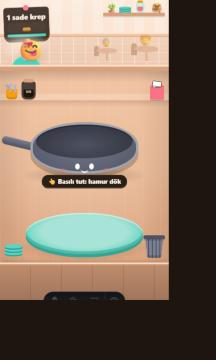

# İlerleme — Batch 02 (Hafta 4)

Görevler: [`tasks/week-4/`](tasks/week-4/README.md) (hocanındır; bu belge onların depo tarafındaki denetim kaydıdır). Görev 16 (Batch 02 denetimi) için ayrı görev kağıdı yoktur; eksikler eğitmenin Hafta 05 durum raporundan alınmıştır: `tauri.conf.json` içinde `minWidth` / `minHeight`, bu belge ve `v0.2.0-batch-02` etiketi. Görevlerin sırası ve dalları: [`gelistirme-plani.md`](gelistirme-plani.md) → Faz 0.5.

## 1. Batch 02 Tamamlama Kontrol Matrisi

Her madde `master` üzerinde tek tek denetlendi (22.10.2026). "Kontrol listesi" sütunu görev kağıdının ✅ listesidir: dal + PR, istem günlüğü, Bölüm 1 maddeleri, Bölüm 3 kendi doğrulamamız, `bun run build` 0 hata.

| No | Görev | Dal / PR | Kanıt | Kontrol |
|:---:|---|---|---|:---:|
| 09.1 | Master koruması | `feature/09-1-master-korumasi` (#61) · `feature/09-1-master-korumasi-kanit` (#69) · `docs/09-1-tamamlandi` (#70) | Kural seti etkin (varsayılan dal; silme ve force-push yasak; 1 onaylı PR; bypass yok); doğrudan push GH013 ile reddedildi; [`kanit/master-korumasi.png`](kanit/master-korumasi.png); "PR güvenliği": [`kurallar.md`](kurallar.md#pr-güvenliği) | [x] |
| 10 | Çalışma yöntemi | `feature/10-calisma-yontemi` (#62) | [`gorev-sartnamesi.md`](gorev-sartnamesi.md), [`istemler/README.md`](istemler/README.md), AGENTS.md §4; günlük ve yeni oturumda kural testi: [`istemler/10`](istemler/10-calisma-yontemi.md) | [x] |
| 11 | Veri sözleşmesi | `feature/11-veri-sozlesmesi` (#63) | `src/lib/types/`, örnek veri `src/lib/veri/ornek.ts`, [`veri-modeli.md`](veri-modeli.md); günlük: [`istemler/11`](istemler/11-veri-sozlesmesi.md) (2 ekran görüntüsü) | [x] |
| 12 | Kart bileşeni | `feature/12-kart-bileseni` (#64) | Genel kart, girdi tipi `types/ui.ts`, sabit renk yok, RTL ve görselsiz durum; günlük: [`istemler/12`](istemler/12-kart-bileseni.md) (4 ekran görüntüsü) | [x] |
| 13 | Liste ve üç durum | `feature/13-liste-ve-uc-durum` (#65) | Yükleniyor / hata / boş / dolu, arama; veri `src/lib/yukleyici.ts` üzerinden; günlük: [`istemler/13`](istemler/13-liste-ve-uc-durum.md) (7 ekran görüntüsü) | [x] |
| 14 | Detay ekranı | `feature/14-detay-ekrani` (#66) | Detay, bulunamadı, geri dönüşte arama korunur; günlük: [`istemler/14`](istemler/14-detay-ekrani.md) (4 ekran görüntüsü) | [x] |
| 15 | Rust komutu ve platform | `feature/15-rust-komutu` (#67) | `fis_olustur` / `fis_coz` tipli sonuç ve hata, tek kapı `src/lib/native.ts`, [`komutlar.md`](komutlar.md), [`platform-destegi.md`](platform-destegi.md); günlük: [`istemler/15`](istemler/15-rust-komutu.md) (4 ekran görüntüsü) | [x] |
| 16 | Batch 02 denetimi | `feature/16-batch-02-denetimi` | `minWidth: 360`, `minHeight: 640` ([`tauri.conf.json`](../src-tauri/tauri.conf.json), [`mimari-agac.md`](mimari-agac.md) §3); bu belge; günlük: [`istemler/16-batch-02`](istemler/16-batch-02-denetimi.md) | [x] |

**Sonuç: 8 / 8.** Hiçbir görev `master`'a doğrudan commit ile girmedi; hepsi PR ile birleşti. #61–#67 kural seti etkinleşmeden önce (09.10) onaysız birleşti; #69'dan beri her PR diğer üyenin onayıyla birleşir.

## 2. Doğrulama Özeti

Güncel `master` + bu dalın değişiklikleri üzerinde (22.10.2026):

| Komut | Sonuç |
|---|---|
| `bun test` | 99 geçti, 0 kaldı (8 dosya) |
| `bun run check` | 69 dosya: 0 hata, 0 uyarı, 0 ipucu |
| `bunx svelte-check --threshold warning` | 0 hata, 0 uyarı |
| `bun run build` | 56 sayfa, `Complete!`, 0 hata |
| `cargo test` (`src-tauri`) | 12 geçti, 0 kaldı (7 adisyon komutu + 5 yerel arka uç, #71) |
| `cargo check` (`src-tauri`) | Yapılandırma geçerli, derleme temiz |

En küçük pencere boyutu (360×640) tarayıcıda denendi: lobi ve servis ekranı sığıyor, yatay ya da dikey kaydırma çıkmıyor (`scrollWidth` 360, `scrollHeight` 640).



## 3. Sürüm Etiketi

Bu belge `master`'a birleştirildikten sonra `master` ucuna Batch 02 etiketi konur:

```bash
git checkout master
git pull origin master
git tag -a v0.2.0-batch-02 -m "Hafta 4: Batch 02 - Çalışma yöntemi, veri sözleşmesi, kart, liste, detay ve Rust komutu tamamlandı"
git push origin v0.2.0-batch-02
```

Doğrulama: `git ls-remote --tags origin v0.2.0-batch-02` ve GitHub'da **Tags** sekmesi.

## 4. Batch 02 sonrası açık işler

Batch 02 kapsamı dışında, Hafta 05 raporundan kalanlar: AGENTS.md'ye dil kuralı ve yönetim panelinin `admin/` altına taşınması. Eğitmenin yerel arka ucu (#71) birleşti; inceleme notları PR'dadır. Takibi [`gelistirme-plani.md`](gelistirme-plani.md) üzerindedir.
