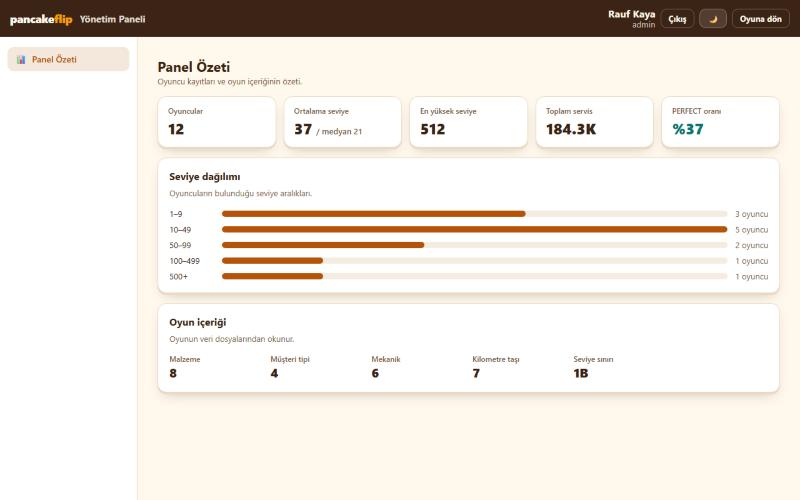

# 20 — Yönetim Paneli 1/4: İskelet, Sözlük, native.ts, Giriş, Panel Özeti

Görev: eğitmenin Hafta 05 raporu, "Yönetim paneli ana projeye" (AI Studio ile `RFKaya/Pancake-flip-2` reposunda üretilen panel `admin/` altına taşınır; dal + PR, sabit renk kodu yok, metinler sözlükten) · Dal: `feature/admin-panel-iskelet`

## Araç ve model

Claude Code (masaüstü uygulaması), model Claude Opus 5.5.

## Şartname

- **Amaç:** Panelin ana projedeki iskeletini kurmak: `/admin` sayfası, kenar menüsü, tema, metin sözlüğü, yerel arka uca giden tipli `native.ts` fonksiyonları, yönetici girişi ve ilk ekran (Panel Özeti).
- **Kapsam dışı:** Diğer 11 ekran (sonraki üç PR); yeni bağımlılık (Tailwind, lucide-react, motion, `@google/genai`, express); eski panelin sahte verisi (`defaultData.ts`), kendi tipleri (`types/game.ts`) ve kendi oyun motoru (`gameEngine.ts`); eski reponun arşivlenmesi (öğrencinin işi).
- **Kabul ölçütleri:** bileşenlerde metin yok (`src/lib/admin-sozluk.ts`); sabit renk kodu yok (yalnız `app.css` değişkenleri); Rust yalnız `native.ts`'ten, tipli sonuç ve tipli hata; tarayıcıda giriş ve oyuncu verisi hiç çizilmez (`destekleniyorMu("yonetim")`); Panel Özeti'nde yükleniyor / hata / boş / dolu hâlleri; `bun test`, `bun run check`, `svelte-check`, `bun run build` temiz.
- **Dokunulacak dosyalar:** `src/pages/admin/index.astro`, `src/layouts/YonetimLayout.astro`, `src/components/admin/{YonetimPaneli,Giris,PanelOzeti}.svelte`, `src/lib/admin-sozluk.ts`, `src/lib/yonetim.ts`, `src/lib/yonetim.test.ts`, `src/lib/types/yonetim.ts`, `src/lib/types/{native,index}.ts`, `src/lib/native.ts`, `src/components/Profil.svelte` (bağlantı), `src/components/Fislerim.svelte` (yeni hata türü), belgeler: `platform-destegi.md`, `komutlar.md`, `mimari-agac.md`, `klasor-mimarisi.md`, `gelistirme-plani.md`, `lat.md/arayuz.md`.
- **Doğrulama adımları:** dört komut; tarayıcıda `/admin` (masaüstü ve 375 px); Tauri'yi taklit eden sahte `invoke` ile giriş, hatalı parola, Panel Özeti ve çıkış.

## İstem

```text
RFKaya/Pancake-flip-2'deki yönetim panelini incele ve ana projede admin/ altına taşımanın planını çıkar; dosya değiştirmeden önce bana göster.
```

```text
Planı önerdiğin kararlarla onaylıyorum; PR1 (iskelet, sözlük, native.ts, giriş, Panel Özeti) ile başla.
```

## Plan (değişiklikten önce sunuldu ve onaylandı)

Eski panelin incelemesi: AI Studio şablonu (React + Vite + Tailwind), 2 commit, yaklaşık 6.900 satır, 12 ekran + 4 pencere; bütün veri kod içinde sahte; renkler zaten projenin değişkenleriyle; yaklaşık 450 Türkçe metin bileşenlerin içinde; Tailwind ve lucide-react ana projede yok.

1. Ayrı bir `admin/` uygulaması yerine Astro rotası: ekranlar `src/components/admin/`, sayfa `src/pages/admin/`.
2. Veri yerel arka uçtan (#71) `native.ts` üzerinden; tarayıcıda salt okunur (JSON), giriş ve oyuncu verisi gizli.
3. Tailwind sınıfları `app.css` değişkenleriyle bileşene özel CSS'e, lucide ikonları emojiye çevrilir; yeni bağımlılık yok.
4. Metinler `src/lib/admin-sozluk.ts`'te; panel şimdilik yalnız Türkçe, başka dil eklenebilir yapıda.
5. Dört PR: iskelet + Panel Özeti → katalog → ayarlar → operasyon.

## Uygulama kararları (planı uygularken)

- **Svelte 5 ile yazıldı.** Eski panel React'ti; ana projenin ekranları Svelte'tir ve ortak `ui/Yukleniyor`, `ui/HataDurumu`, `ui/BosDurum` bileşenleri ile tema store'u Svelte'tedir. Tailwind zaten baştan CSS'e çevrileceği için çerçeveyi de projeninkine almak ek iş getirmedi; bu ortak parçalar yeniden kullanıldı.
- **Panel Özeti yalnız gerçek veriyi gösterir.** Eski ekrandaki "Kritik terk eşikleri" (%14, %28 … elle yazılmış terk oranları), tarih aralığı düğmeleri (hiçbir şeyi süzmüyordu) ve CSV/JSON indirme taşınmadı. KPI'lar arka ucun `pancake_dashboard` sonucundaki alanlardır; "aktif oyuncu" ve "kasa hacmi" bu sonuçta olmadığı için gösterilmez.
- **Oyun içeriği kartı** (malzeme, müşteri tipi, mekanik, kilometre taşı sayısı, seviye sınırı) JSON'dan okunur; tarayıcıda da görünür. Böylece tarayıcıda sayfa boş kalmaz, uyarı ya da devre dışı düğme de çizilmez.
- **Ayrı iskelet:** `/admin` oyuncu alt menüsünü ve üst başlığı göstermez (`YonetimLayout.astro`); tema betiği `Layout.astro` ile aynıdır.
- **Uygulamada erişim:** Tauri penceresinde adres çubuğu olmadığı için Profil → Bilgi listesine **Yönetim Paneli** bağlantısı eklendi; yalnız `destekleniyorMu("yonetim")` doğruysa çizilir.
- **Arka uç hataları:** `{ code, message, errors? }` biçimi `native.ts`'te `{ tur: "ArkaUc", kod, mesaj, alanlar? }` hatasına çevrilir; iletiler Türkçe geldiği için olduğu gibi gösterilir.

## Düzeltmeler

- `NativeHata`'ya `ArkaUc` eklenince `Fislerim.svelte`'deki her hata türünü karşılayan `switch` eksik kaldı (`svelte-check`: "Function lacks ending return statement"). İlgili dal eklendi.
- Testteki beklenen sonuç nesnesi tip olarak `NativeSonuc`'a uymadı (`bun run check` 5 hata); nesneye açık tip verildi.
- Panel Özeti'ndeki "medyan" yazısı ilk taslakta sözlükteki başka bir metnin küçük harfe çevrilmesiyle üretiliyordu; sözlüğe ayrı bir `medyan` metni kondu.

## Doğrulama

```text
$ bun test
105 pass, 0 fail   (yeni: src/lib/yonetim.test.ts, 6 test)

$ bun run check
Result (75 files): 0 errors, 0 warnings, 0 hints

$ bunx svelte-check --threshold warning
0 ERRORS 0 WARNINGS

$ bun run build
57 page(s) built ... Complete!   (yeni: /admin/index.html)
```

Tarayıcı (127.0.0.1:1420/admin):

- **Tarayıcı hâli:** giriş formu ve oyuncu istatistikleri yok; yalnız "Oyun içeriği" (8 malzeme, 4 müşteri tipi, 6 mekanik, 7 kilometre taşı, seviye sınırı 1B). Konsolda hata yok. 375 px genişlikte yatay kaydırma yok (`scrollWidth` 375).
- **Uygulama hâli (taklit):** Sayfada `isTauri` ve `__TAURI_INTERNALS__.invoke` Rust'ın döndürdüğü biçimde sahte yanıtlarla tanımlandı ve panel yeniden bağlandı. Sıra: `auth_me` → `null` → giriş formu; hatalı parola → arka ucun iletisi ("E-posta ya da parola hatalı.") formda; doğru parola → `auth_login` → `pancake_dashboard` → KPI'lar, dağılım çubukları ve içerik kartı; tema düğmesi gündüz/gece arasında geçiyor; **Çıkış** → `auth_logout` → giriş formu.



Gerçek Tauri uygulamasında (gerçek SQLite ile) elle denenmedi. Öğrencinin denemesi: `bun run tauri dev` → Profil → **Yönetim Paneli** → **Hesap oluştur** (ilk hesap yönetici olur) → Panel Özeti "Henüz oyuncu kaydı yok" göstermeli (veritabanında oyuncu yok).
