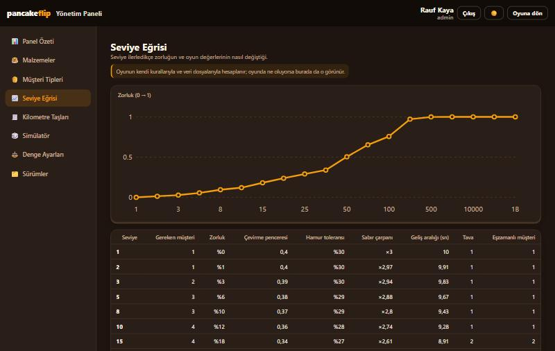

# 22 — Yönetim Paneli 3/4: Seviye Eğrisi, Kilometre Taşları, Simülatör, Denge, Sürümler

Görev: eğitmenin Hafta 05 raporu, "Yönetim paneli ana projeye" (plan: [20](20-admin-panel-iskelet.md)) · Dal: `feature/admin-panel-ayarlar` (#77'nin dalı üzerinde)

## Araç ve model

Claude Code (masaüstü uygulaması), model Claude Opus 5.5.

## Şartname

- **Amaç:** Eski panelin oyun ayarı ekranlarını taşımak: Seviye Eğrisi, Kilometre Taşları, Simülatör, Denge Ayarları, Sürümler.
- **Kapsam dışı:** Oyuncular, Fişler, Şüpheli Kayıtlar, Denetim Günlüğü (4. aşama); seviye yapılandırmasının (`seviye.json`) düzenlenmesi; yayınlanan ayarların oyuna aktarılması (oyun JSON'u kullanır); yeni bağımlılık.
- **Kabul ölçütleri:** eğri, çizelge ve simülatör oyunun kendi TypeScript kurallarından (`src/lib/oyun/`) hesaplanır, kuralların ikinci bir kopyası yazılmaz; Denge düzenlemesi taslak `ContentVersion` olarak kaydedilir, yayın ve geri alma Sürümler'de arka ucun `content_publish` / `content_rollback` komutlarıyla yapılır; tarayıcıda düzenleme ve Sürümler hiç çizilmez; metinler sözlükte; sabit renk yok.
- **Dokunulan dosyalar:** `src/components/admin/{SeviyeEgrisi,KilometreTaslari,Simulator,DengeAyarlari,Surumler,EkranBasligi,YonetimPaneli}.svelte`, `src/lib/{native,yonetim,admin-sozluk,yonetim.test}.ts`, `src/lib/types/yonetim.ts`, `src/lib/oyun/seviye.ts` (`tumAcilislar` dışa açıldı), belgeler: `komutlar.md`, `mimari-agac.md`, `platform-destegi.md`, `gelistirme-plani.md`, bu günlük.

## İstem

```text
Devam et
```

(Önceki adım: PR2 açılmıştı; sıradaki iş plandaki 3. aşamaydı.)

## Uygulama kararları

- **Eski panelin kendi oyun motoru taşınmadı.** Eski `gameEngine.ts` seviye eğrisini ve siparişleri ayrı bir kopya kodla hesaplıyordu. Burada eğri `seviyeAyari`, çizelge `tumAcilislar`, örnek siparişler `siparisUret` + `rngOlustur` ile hesaplanır; oyunda ne oluyorsa panelde de o görünür. Bu yüzden bu üç ekran tarayıcıda da çalışır.
- **Simülatör "seviye değerleri + örnek siparişler" olarak kuruldu.** Eski ekrandaki elle tabak dizip puan alma bölümü taşınmadı; örnek siparişler tohumla tekrarlanabilir (🎲 yeni tohum).
- **Denge → taslak → Sürümler → yayın.** Arka uçtaki sürüm düzeni (#71) bunu bekliyor: `content_publish` önce içeriği doğrular (`dogrula_icerik`), sonra `game_configs`'i günceller. Panel kendisi de aynı kalite kuralını önceden denetler. Taslak kimliği `ayarlar-<sürüm>`; sürüm numarası kayıtlı sürümlerin ve yayındaki ayarın en büyüğünden bir fazla.
- Ortak başlık bileşeni (`EkranBasligi.svelte`) yalnız yeni ekranlarda kullanıldı; önceki ekranlara dokunulmadı.

## Düzeltmeler

- Denge'de iç içe olmayan alanlar (`pismeSuresi`, `tabakMax` …) her biri ayrı bir grup oluyordu; "Genel" grubunda toplandı.
- `Object.groupBy` projenin hedef kütüphanesinde olmadığı için `alanGruplari` yardımcı fonksiyonuyla değiştirildi.
- Arka uç `content_publish`'te notu olduğu gibi yazıyor (boşsa siler); yayın penceresi taslağın notuyla dolu açılacak şekilde düzeltildi, yoksa Denge'de yazılan not kayboluyordu.
- Sürümler tablosunda durum sütununun başlığı yanlış metni gösteriyordu ("Sürümler"); sözlüğe "Durum" eklendi.
- Önceki aşamada (#77) güncellenmeyen `komutlar.md` ve `mimari-agac.md` satırları bu aşamada tamamlandı.

## Doğrulama

```text
$ bun test                              → 119 pass, 0 fail (yeni 7 test)
$ bun run check                         → 0 errors, 0 warnings, 0 hints
$ bunx svelte-check --threshold warning → 0 errors, 0 warnings
$ bun run build                         → 57 page(s) built, Complete!
```

Tarayıcı (`/admin`):

- **Tarayıcı hâli:** menüde Sürümler yok; Seviye Eğrisi (çizgi + tablo), Kilometre Taşları, Simülatör (seviye 15: zorluk %18, 2 tava, örnek siparişler) çalışıyor; Denge salt okunur, kaydet düğmesi yok.
- **Uygulama hâli (sahte `invoke`):** Denge'de `kalite.good` 95 → "Kalite eşikleri perfect ≥ great ≥ good olmalı."; düzeltip `perfectBonus` 7 + not → `crud_store` ile `ayarlar-2` taslağı. Sürümler'de yayınla → `ayarlar-2` yayında; ikinci taslak (`tabakMax` 10) yayınlanınca `ayarlar-2` geri alındı; Geri al düğmesi neden boşken kapalı, nedenle `content_rollback` → `ayarlar-2` yeniden yayında.



Gerçek Tauri uygulamasında denenmedi.
